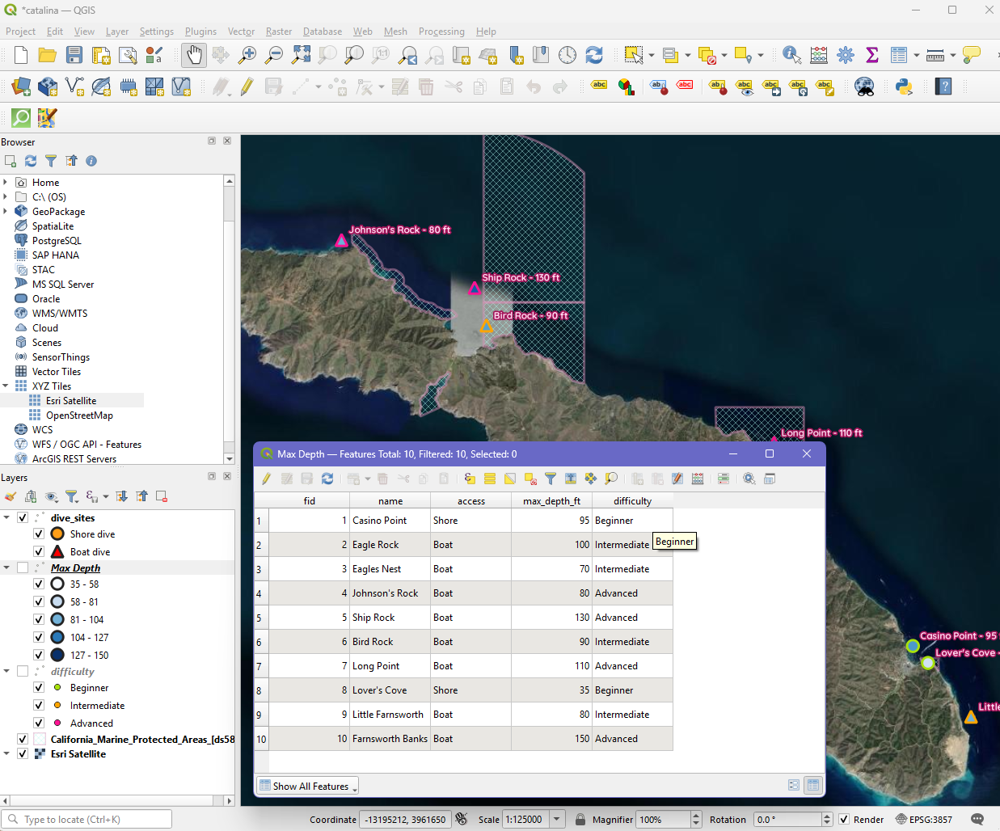

# Catalina Island Dive Sites

This map accounts for ten of the more popular scuba dive sites around Catalina Island and would be good to use as an informative dive guide. Each site is symbolized by maximum depth (fill color), difficulty/certification level needed (ring color: lime = beginner, orange = intermediate, pink = advanced), and access type (circle = shore dive, triangle = boat dive). California Marine Protected Area boundaries are shown to help plan around regulated zones and indicate that special accommodations may be needed to dive there.

**Live map:** https://pco273.github.io/catalina-dive-map/

## Why I Created This Map
I worked and played on Catalina Island for many years throughout my life. It is where I first found my passion for environmental education and marine studies and is what drove me to get my scuba certification. So far I've only been to a couple of these sites but hope to one day make it to all ten!

## Data Sources
- **Dive sites (locations, depth, difficulty, access):** Compiled from 
  PADI dive-site pages. https://www.padi.com/dive-sites
- **Marine Protected Area boundaries:** California Marine Protected Areas [ds582], 
  California Department of Fish & Wildlife, Marine Region GIS Lab (data as of Jan 1, 2019). 
  https://data-cdfw.opendata.arcgis.com/datasets/CDFW::california-marine-protected-areas-ds582
- **Satellite base map:** Esri World Imagery (XYZ tile service).

## Projection
- **Original data:** Dive site points created in WGS 84 (EPSG:4326); MPA data from CDFW 
  and satellite base map in Web Mercator (EPSG:3857).
- **Final map:** displayed in Web Mercator (EPSG:3857); dive point data stored in WGS 84 (EPSG:4326).

## How I Created This Map
Here is a step by step of how I was able to create this map. 

1. Add Satellite layer: Added Esri World Imagery as a base layer and zoomed into Catalina Island.

2. Create Dive Site Layer: In QGIS, I created a new 
   GeoPackage point layer (EPSG:4326) with fields for name, max depth (ft), 
   difficulty, and access. I placed a point for each of the ten dive sites 
   using a reference map and the QGIS locator, and entered the attributes of each one at a time. 

3. Used rule based symbology to get the symbol to match what I wanted them to represent: fill color = max depth (graduated Blues), marker ring color = difficulty (lime/orange/pink), marker shape = access (circle = shore, triangle = boat). 

4. Labeling each site: indicating site name and numerical depth, changing to pink font with a darker pink halo to make it easy to read

5. Adding MPAs: found and downloaded the CDFW 
   MPA GeoJSON, added it, styled it with a cross hatch so boundaries show 
   around the island without blocking views.

6. Put together print layout:  added map, title, legend, north arrow, scale bar, and a metadata block.

7. exported two resolutions for website: used 150 dpi for smaller web version and a full-resolution version at 300 dpi

8. publish public website: created an index.html page displaying the 
   map, uploaded everything to a GitHub repository, and published it with GitHub Pages. 

## Repository
This project's files: https://github.com/pco273/catalina-dive-map
